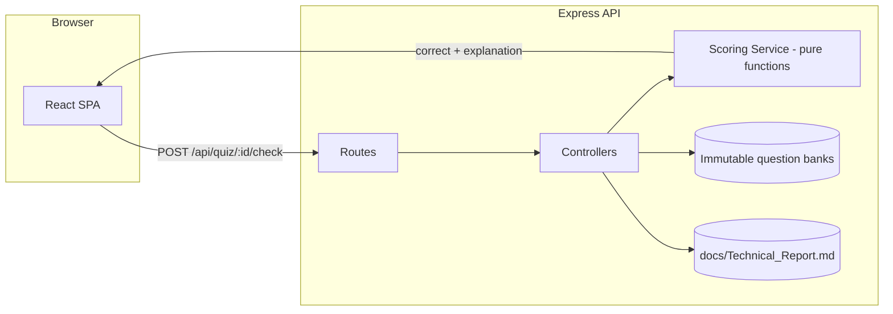

# DevAssess Pro

> A production-ready, open-source technical assessment platform: **QCM quizzes**, a
> **logical analysis engine** with instant server-side scoring, and a full
> **software engineering case study** module — built with React, Tailwind CSS and
> a Node.js/Express REST API.


---

## Why DevAssess Pro

Most lightweight quiz apps ship the correct answers inside the JavaScript bundle.
DevAssess Pro inverts that model: **the browser never sees a solution.**

- Questions are serialized through an **allow-list projection** (`answer` and
  `explanation` are stripped server-side).
- Every candidate selection is verified by a `POST` round-trip — **instant
  scoring** with a written explanation.
- Final grades are computed **server-side** (`score`, `percentage`, `passed`,
  full breakdown), so results are auditable and tamper-proof.

### Features

| Module | What you get |
| ------ | ------------ |
| **QCM Quiz Engine** | 60 questions across 6 tracks, per-answer verification, progress tracking, 70% pass mark, full answer review |
| **Logical Analysis** | Number series, syllogisms, spatial reasoning, coding-decoding puzzles — all instantly scored |
| **Technical Case Study** | A complete engineering report (architecture, ADRs, security, testing, CI/CD, risk register) rendered in-app and served by the API |
| **Modern UI** | React 18 + Tailwind CSS, dark mode (class strategy, no FOUC), fully responsive, keyboard accessible |
| **REST API** | 7 documented endpoints, validation, rate limiting, security headers, health probe |
| **Open source** | MIT licensed, minimal dependencies, one-command setup, CI matrix on Node 18/20/22 |

### Quiz tracks

| ID | Track | Questions | Topics |
| -- | ----- | --------- | ------ |
| `dsa` | Data Structures & Algorithms | 10 | Complexity, sorting, trees, graphs, DP |
| `oop` | Object-Oriented Programming | 10 | Four pillars, SOLID, polymorphism, composition |
| `web-frontend` | HTML, CSS & JavaScript | 10 | Semantics, box model, events, a11y, responsive |
| `mern` | MERN Stack Development | 10 | MongoDB, Express, React hooks, REST, JWT security |
| `aspnet` | ASP.NET Core & C# | 10 | Middleware, DI lifetimes, EF Core, async actions |
| `logical` | Logical Analysis & Puzzles | 10 | Series, syllogisms, rates, spatial, coding |

---

## Tech stack

| Layer | Technology |
| ----- | ---------- |
| Frontend | React 18, React Router 6, Vite 5, Tailwind CSS 3.4 (+ Typography), react-markdown |
| Backend | Node.js ≥ 18.17, Express 4, Helmet, CORS, express-rate-limit, morgan, dotenv |
| Testing | `node:test` + `node:assert` (zero-dependency unit tests) |
| CI | GitHub Actions (Node 18 / 20 / 22 matrix) |

---

## Architecture



**Dependency rule:** `routes → controllers → services → data`. The scoring
service is a pure function with no I/O, which is why it can be unit-tested in
milliseconds and extracted later without touching HTTP code.

Full design details — trust boundaries, ERD, sequence diagrams, ADRs, risk
register — live in
**[docs/Technical_Report.md](docs/Technical_Report.md)** and are also served
in-app at **`/report`**.

---

## Quick start

### Prerequisites

- **Node.js ≥ 18.17** (tested on 18, 20, 22, 24) and npm 9+

### 1. Clone and install

```bash
git clone https://github.com/baraaakkawi073-lgtm/devassess-pro.git
cd devassess-pro
npm install          # installs root + server + client dependencies
```

### 2. Configure (optional)

```bash
cp .env.example .env
```

Sensible defaults work out of the box — you can skip this step.

### 3. Run in development mode

```bash
npm run dev
```

| Service | URL |
| ------- | --- |
| Web app (Vite, HMR) | http://localhost:3000 |
| REST API | http://localhost:5000 |
| Health probe | http://localhost:5000/api/health |

The Vite dev server proxies `/api` to the Express API, so there are no CORS
issues during development.

### 4. Production build (single origin)

```bash
npm run build   # builds client/dist
npm start       # Express serves the API + the built SPA
```

Open http://localhost:5000 — one process, one origin, zero CORS configuration.

---

## Project structure

```
devassess-pro/
├── .github/workflows/ci.yml     # CI: install → test → build (Node 18/20/22)
├── docs/
│   └── Technical_Report.md      # Architecture case study (served at /api/report)
├── server/                      # Express REST API (ESM)
│   ├── package.json
│   └── src/
│       ├── server.js            # App wiring, security, rate limit, static SPA
│       ├── config.js            # env + path configuration
│       ├── controllers/         # HTTP validation & orchestration
│       ├── data/                # 6 question banks + repository boundary
│       ├── middleware/          # ApiError, 404, central error handler
│       ├── routes/              # /api/quiz, /api/report, /api/health
│       └── services/
│           ├── scoring.service.js       # pure grading logic
│           └── scoring.service.test.js  # unit tests (node:test)
├── client/                      # React SPA (Vite + Tailwind)
│   ├── index.html
│   ├── tailwind.config.js
│   ├── vite.config.js           # dev proxy + JSX-in-.js transform
│   └── src/
│       ├── App.js               # router + layout
│       ├── api.js               # typed fetch wrapper
│       ├── constants.js         # category accents, difficulty styles
│       ├── components/          # Navbar, QuizEngine, QuestionCard, Results...
│       ├── context/             # ThemeContext (dark mode)
│       └── pages/               # Home, QuizPage, ReportPage
├── .env.example
├── CONTRIBUTING.md
├── LICENSE                      # MIT
└── package.json                 # workspace scripts (dev/build/test)
```

---

## API reference

Base URL: `http://localhost:5000/api` · JSON in/out · all errors follow
`{ "success": false, "error": { "message": "..." } }`.

| Method | Endpoint | Description |
| ------ | -------- | ----------- |
| `GET` | `/health` | Service health: version, environment, uptime |
| `GET` | `/quiz/categories` | All tracks with metadata and topic lists |
| `GET` | `/quiz/:categoryId` | Questions **without** answers/explanations |
| `POST` | `/quiz/:categoryId/check` | Instant verification of one answer |
| `POST` | `/quiz/:categoryId/evaluate` | Grade a complete attempt |
| `GET` | `/report` | Technical report as `{ title, source, markdown }` |
| `GET` | `/report/raw` | Raw `text/markdown` download |

### Examples

```bash
# Categories
curl http://localhost:5000/api/quiz/categories

# Questions (notice: no "answer", no "explanation")
curl http://localhost:5000/api/quiz/logical

# Instant scoring for question log-01, option index 2
curl -X POST http://localhost:5000/api/quiz/logical/check \
  -H "Content-Type: application/json" \
  -d '{"questionId":"log-01","selected":2}'

# Grade a full attempt
curl -X POST http://localhost:5000/api/quiz/dsa/evaluate \
  -H "Content-Type: application/json" \
  -d '{"answers":{"dsa-01":1,"dsa-02":1,"dsa-03":2}}'
```

**Evaluate response (excerpt)**

```json
{
  "success": true,
  "score": 3,
  "total": 10,
  "percentage": 30,
  "passed": false,
  "threshold": 70,
  "unanswered": ["dsa-04", "dsa-05"],
  "breakdown": [ { "id": "dsa-01", "correct": true, "explanation": "..." } ]
}
```

---

## Environment variables

| Variable | Default | Where | Purpose |
| -------- | ------- | ----- | ------- |
| `PORT` | `5000` | server | API listen port |
| `NODE_ENV` | `development` | server | `development` / `production` / `test` |
| `CLIENT_ORIGIN` | `http://localhost:3000` | server | CORS allow-list (comma-separated) |
| `RATE_LIMIT_MAX` | `300` | server | Requests per IP per 15 min on `/api` |
| `VITE_API_PROXY` | `http://localhost:5000` | client | Dev proxy target for `/api` |
| `VITE_API_URL` | *(unset → `/api`)* | client | Absolute API base (split-origin deploys) |

---

## Scripts

| Command | Description |
| ------- | ----------- |
| `npm install` | Installs root, server and client dependencies |
| `npm run dev` | API (`--watch`) + Vite dev server concurrently |
| `npm run build` | Production build of the React client |
| `npm start` | Start Express (serves API + built client) |
| `npm test` | Unit tests for the scoring engine |
| `npm run install:all` | Install workspace dependencies only |

---

## Testing

```bash
npm test
```

8 unit tests cover the scoring domain: answer-leak prevention (allow-list
projection), correct/incorrect grading, percentage and pass-threshold
arithmetic, unanswered handling, type coercion and the empty-bank edge case.
CI additionally fails the build if the production client bundle does not
compile.

---

## Deployment

**Single host (simplest):**

```bash
npm ci && npm run build && NODE_ENV=production npm start
```

Deploy the repository to any Node host (Render, Railway, Fly.io, a VM, a
container). The Express server serves `client/dist` and the API from one
origin.

**Split origin:** host `client/dist` on a static provider and the API
separately; set `CLIENT_ORIGIN` on the API to the SPA origin and
`VITE_API_URL` at build time.

---

## Documentation

- 📘 [Technical Report & Architecture Case Study](docs/Technical_Report.md)
- 🤝 [Contributing guide](CONTRIBUTING.md)
- ⚖️ [MIT License](LICENSE)

---

## Roadmap

- Persistent question store (SQLite → PostgreSQL) and attempt history
- User accounts with JWT + refresh rotation
- Adaptive difficulty and per-topic mastery heatmaps
- Playwright E2E suite with axe-core accessibility gating
- Time-boxed exams and randomized question ordering

Contributions, issue reports and question PRs are welcome — see
[CONTRIBUTING.md](CONTRIBUTING.md).

---

## License

MIT © DevAssess Pro Contributors. See [LICENSE](LICENSE).
